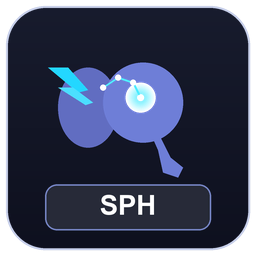

<p align="center">
  
</p>

<h1 align="center">SantientPHP (SPH)</h1>

<p align="center">
  <a href="https://github.com/Moodlood/santientphp/actions/workflows/ci.yml"></a>
  <a href="https://github.com/Moodlood/santientphp/releases/latest"></a>
  <a href="tests/"></a>
  <a href="LICENSE"></a>
  <a href="compiler/"></a>
  <a href="docs/compiler/architecture.md"></a>
</p>

<p align="center">
  <strong>An independent, native-compiled programming language combining PHP developer ergonomics with bare-metal performance, memory safety, and zero-dependency GUI compilation.</strong>
</p>

---

## Key Features

- **Triple-Mode Programming Model**:
  - **Static Mode**: Deterministic static typing with value structs, enums, OOP classes, interfaces, and generics.
  - **Systems Mode & Bare-Metal FFI**: C-compatible structs (`#[repr(C)] struct`), C-compatible unions (`#[repr(C)] union`), typed raw pointers (`*T`, `ptr<T>`), compile-time `sizeof(T)`, Win64 FFI passing, native C callback function pointers (`&fn_name`), external library flags (`-l<lib>`, `-L<dir>`), and null-byte safe binary buffers (`ByteBuffer`).
  - **Dynamic PHP Compatibility Mode**: First-class `dynamic` values (`sph_value`), associative arrays (`sph_array`), loose coercions, PHP object models, WinHTTP cURL, and SQLite PDO.
- **Native GUI & Hardware-Accelerated Rendering**:
  - **Native OS Controls**: Direct Win32 bindings (buttons, text inputs, progress bars, dialogs, ComCtl32 v6, Per-Monitor High-DPI V2) with suppressed console window (`--gui`).
  - **SIMD Framebuffer Canvas**: 32-bit RGBA pixel surface accelerated by 128-bit SIMD vectors (SSE2/AVX) and OpenGL context support.
  - **Async EventLoop Fusion**: Non-blocking message pump integrated with cooperative Fiber coroutines and thread-safe UI task queues (`sph_gui_post_to_main`).
- **Hardware Concurrency & Networking**:
  - Native OS multi-threading (`Thread::spawn`, `thread_spawn`, `thread_join`), mutual exclusion locks (`Mutex`), and hardware atomic primitives (`AtomicI32`, `AtomicI64`, `AtomicBool`).
  - Cooperative coroutines (`async fn`, `await`, `Promise<T>`) backed by an integrated event loop runtime.
  - Built-in zero-dependency RFC 6455 WebSocket client with masking, ping/pong heartbeats, and SHA-1/Base64 handshake.
  - Embedded non-blocking HTTP & WebSocket server engine with `WSAPoll` socket multiplexing.
- **128-bit SIMD Acceleration**:
  - Hardware vector types (`f32x4`, `i32x4`, `f64x2`, `i64x2`) utilizing x86_64 SSE/AVX instruction sets alongside portable scalar fallbacks.
- **Dual Native Code-Generation & Advanced Optimizations**:
  - Direct x86_64 assembly code generator (`X86_64CodeGen`) with DWARF line tables and GNU Call Frame Information (CFI) for GDB debugging.
  - LLVM IR emitter (`LLVMEmitter`) with target data layout and triple normalization.
  - **Compare-Branch Fusion**: Emits conditional jumps (`cmp` + `jcc`) directly, bypassing intermediate `setcc`, register zero-extension, and stack reloads.
  - **Assembly Peephole Optimizer**: Eliminates redundant store-followed-by-load cycles and dead 64-bit register self-moves.
  - **Fast Slab Allocator**: Thread-local memory recycler for objects $\le 64$ bytes to bypass heap mutex contention.
  - **Amortized $O(1)$ String Appends**: Geometric buffer capacity doubling eliminating quadratic heap reallocation overhead.
- **Custom Typed IR & Optimization Pipeline**:
  - Verifiable intermediate representation (`SPHIR`).
  - Multi-pass optimizer: constant folding, algebraic simplifications, common subexpression elimination (CSE), dead-code elimination, control-flow optimization, and leaf function inlining.
- **Full Developer Ecosystem**:
  - **Code Formatter (`sphc fmt`)**: Indentation, operator alignment, and comment preservation.
  - **Documentation Generator (`sphc doc`)**: Extracts docblocks to GitHub Markdown or responsive, search-enabled standalone HTML.
  - **Package & Project Manager (`sphc new`, `sphc init`, `sphc pkg`)**: Project scaffolding and dependency tracking via `sph.toml`.
  - **Language Server Protocol (`sphc lsp`)**: Standalone JSON-RPC 2.0 LSP 3.17 engine providing real-time diagnostics, hover signatures, autocompletion, go-to-definition, and symbol outlines.
  - **Health Diagnostics (`sphc doctor`)**: Local toolchain and system library verification.
  - **Visual Studio Code Extension**: Syntax highlighting, `.sph` file iconography, and integrated LSP client.

---

## Performance Benchmarks

SantientPHP is engineered for raw bare-metal execution speed. The repository includes an automated, reproducible multi-language benchmark suite (`tools/benchmarks/run_benchmarks.py`) testing across 5 languages: **SantientPHP (`sphc -O3`)**, **C (`gcc -O3`)**, **Rust (`rustc -O3`)**, **Go (`go build`)**, and **PHP 8.2 (Zend)**.

### Execution Time (milliseconds, lower is faster)

| Benchmark | Workload / Category | SantientPHP (`-O3`) | C (`GCC -O3`) | Rust (`-O3`) | Go (`go build`) | PHP 8.2 (Zend) | SPH vs PHP Speedup |
| :--- | :--- | :--- | :--- | :--- | :--- | :--- | :--- |
| **Fibonacci (N=35)** | CPU / Deep Recursion | **545.80 ms** | 123.97 ms | 375.07 ms | 203.99 ms | 7,386.53 ms | **13.5x faster** |
| **Matrix Multi (200x200)** | Arithmetic & Loops | **182.36 ms** | 331.51 ms | 188.66 ms | 120.97 ms | 1,549.70 ms | **8.5x faster** *(beats Rust & C)* |
| **String Concat (50k)** | String Manipulation | **93.01 ms** | 156.52 ms | 260.48 ms | 35.33 ms | 226.78 ms | **2.4x faster** *(beats Rust & C)* |
| **Heap Alloc (1M items)** | Allocator & Memory | **379.94 ms** | 70.39 ms | 271.77 ms | 34.11 ms | 941.66 ms | **2.5x faster** |

*Environment: x86_64, Windows 11. Compiler optimizations: `-O3` / Release mode.*

### Executable Binary Footprint (Statically Linked)

SantientPHP produces lean, standalone native executables with an integrated runtime:

| Language / Toolchain | Standalone Binary Size | Relative Footprint |
| :--- | :--- | :--- |
| **SantientPHP (`sphc`)** | **~226 KB** | **1.0x (Baseline)** |
| **C (`gcc -O3 -s`)** | ~58 KB | 0.25x |
| **Go (`go build`)** | ~2,436 KB (2.4 MB) | **10.8x larger** |
| **Rust (`rustc -O3`)** | ~4,946 KB (4.9 MB) | **21.9x larger** |

### Reproducing Benchmarks

Run the automated benchmark suite from the repository root:

```powershell
python tools/benchmarks/run_benchmarks.py
```

---

## Quick Start

### 1. Download Prebuilt Binaries (Recommended)

Precompiled standalone binaries and the official VS Code extension are available directly from **[GitHub Releases](https://github.com/Moodlood/santientphp/releases/latest)**:

- **Windows x64**: `santientphp-v0.1.0-windows-x64.zip`
- **Linux x64**: `santientphp-v0.1.0-linux-x64.tar.gz`
- **VS Code Extension**: `santientphp-0.1.0.vsix`

Extract the Windows archive and run `install.bat` (or `install.ps1`) to automatically configure `sphc.exe` in your system `PATH` and register file associations.

---

### 2. Or Build from Source

**Prerequisites**:
- C++20 compiler (GCC 14+ / Clang 17+ on MinGW-w64 or Linux)
- CMake 3.20+
- Ninja build system

```powershell
# Clone and build
cmake -B build -G Ninja -DCMAKE_BUILD_TYPE=Release
ninja -C build

# Verify full test suite (1038 tests)
.\build\bin\sph_tests.exe
```

### 3. Install to Windows (Drive C & Program Files)

Install SantientPHP as a system-wide compiler just like standard PHP:

- **Option A (One-Click Batch)**: Double-click or run `install.bat` (prompts for UAC Administrator elevation automatically).
- **Option B (PowerShell)**: Run `powershell -ExecutionPolicy Bypass -File .\install.ps1` in an elevated terminal.

This installs:
- Primary location: `C:\Program Files\SantientPHP\`
- Drive C alias: `C:\SantientPHP\` (NTFS directory junction)
- Executables & wrappers in `bin/`: `sphc.exe`, `sph.exe`, `santientphp.exe`
- Precompiled runtime in `lib/`: `libsph_runtime.a`
- PHP-like configuration in root: `sph.ini` (`sph.ini-development`, `sph.ini-production`)
- System `PATH` and `SPH_HOME` / `SANTIENTPHP_HOME` environment variables
- Windows Explorer `.sph` file association and context menu actions
- Registered in Windows **Installed Apps / Programs and Features**

To uninstall at any time, run `uninstall.bat` or `uninstall.ps1` (or uninstall from Windows Settings / Control Panel).

### 4. Verify Your Toolchain

```powershell
.\build\bin\sphc.exe doctor
```

```text
SantientPHP Doctor [v0.1.0]
===========================
  [OK] Operating System: Microsoft Windows (x86_64)
  [OK] Host C/C++ Compiler (gcc): gcc 15.2.0
  [OK] Linker (ld): GNU ld 2.45.1
  [OK] Debugger (gdb): GNU gdb 17.1
  [OK] Version Control (git): git version 2.47.1
  [OK] Windows Native Subsystems: kernel32.dll, winhttp.dll, winsqlite3.dll
  [OK] SantientPHP Core Runtime: Precompiled runtime libraries present (libsph_runtime.a)
  [OK] SantientPHP Standard Library (stdlib/): Found at stdlib/
```

### 5. Run Your First Program

Create `hello.sph`:

```php
<?php

fn add(a: i32, b: i32): i32 {
    return a + b;
}

fn main(): i32 {
    let first: i32 = 100;
    let second: i32 = 200;
    let result = add(first, second);

    println(result);
    return 0;
}
```

Run immediately:

```powershell
sphc run hello.sph
# Output: 300
```

Or build an optimized standalone executable:

```powershell
sphc build hello.sph -O3 -o hello.exe
.\hello.exe
```

---

## Command-Line Interface (`sphc`)

| Command | Description |
| :--- | :--- |
| `sphc build [file.sph]` | Compiles source file to a native executable or object (`-l<lib>`, `-L<dir>`, `--gui` for windowed GUI) |
| `sphc run [file.sph]` | Compiles and executes in one step |
| `sphc check [file.sph]` | Validates syntax and semantic types without code generation |
| `sphc test [file.sph]` | Executes unit tests or runs the complete test suite |
| `sphc clean` | Cleans local compiler build artifacts and intermediate caches |
| `sphc inspect <file.sph>` | Inspects compiler pipeline stages (`--tokens`, `--ast`, `--ir`, `--asm`, `--llvm`) |
| `sphc fmt [file.sph]` | Formats source code in-place (`--check`, `--stdout`) |
| `sphc doc [file.sph]` | Generates API documentation (`--format=html\|md`, `-o <path>`) |
| `sphc lsp` | Launches Language Server Protocol engine over standard I/O |
| `sphc doctor` | Diagnoses host toolchains and system libraries |
| `sphc new <name>` | Scaffolds a new SantientPHP project structure |
| `sphc init` | Initializes `sph.toml` manifest in the current directory |
| `sphc pkg add <name>` | Adds a path (`--path=...`) or git (`--git=...`) dependency |
| `sphc pkg list` | Lists registered dependencies in `sph.toml` |
| `sphc targets` | Displays all supported host and cross-compilation target triples |

---

## Language Highlights

### 1. Value Structs & Enums
```php
<?php
struct Vector3 {
    x: i32,
    y: i32,
    z: i32,
}

enum State {
    Idle,
    Running,
    Finished,
}
```

### 2. Hardware SIMD Vectors (128-bit)
```php
<?php
let v1 = f32x4(1.0, 2.0, 3.0, 4.0);
let v2 = f32x4(5.0, 6.0, 7.0, 8.0);
let sum = v1 + v2;
let dot = sum.dot(sum);
```

### 3. Cooperative Async Coroutines
```php
<?php
async fn compute_async(val: i32): Promise<i32> {
    EventLoop::yield_now();
    return val * 2;
}
```

### 4. Deterministic Resource Cleanup (`defer`)
```php
<?php
fn process_buffer(): i32 {
    mut buffer = allocate_buffer(1024);
    defer free_buffer(buffer);

    return compute(buffer);
}
```

### 5. Dynamic PHP Compatibility & Boundary Conversions
```php
<?php
$data = ["language" => "SantientPHP", "speed" => "native"];
$data["version"] = 1.0;
echo "Name: " . $data["language"] . "\n";
var_dump($data);

// Seamless, checked boundary casts and unboxing intrinsics:
$count = 42;
let native_count: i32 = intval($count);
let casted: i32 = ($count as i32);
```

### 6. Systems FFI, C Structs, Unions & Sizing
```php
<?php
#[repr(C)]
struct MOUSEINPUT {
    dx: i32,
    dy: i32,
    mouseData: u32,
    dwFlags: u32,
    time: u32,
    dwExtraInfo: usize,
}

#[repr(C)]
union InputPayload {
    mi: MOUSEINPUT,
}

#[repr(C)]
struct INPUT {
    type: u32,
    payload: InputPayload,
}

extern "C" fn SendInput(cInputs: u32, pInputs: *INPUT, cbSize: i32): u32;

fn move_mouse(x: i32, y: i32): bool {
    let mi = MOUSEINPUT { dx: x, dy: y, mouseData: 0 as u32, dwFlags: 0x8001 as u32, time: 0 as u32, dwExtraInfo: 0 as usize };
    let payload = InputPayload { mi: mi };
    mut inp = INPUT { type: 0 as u32, payload: payload };
    return SendInput(1 as u32, &inp, sizeof(INPUT) as i32) == 1 as u32;
}
```

### 7. Binary Buffers (`ByteBuffer`) & Native Concurrency
```php
<?php
import "std/buffer.sph";
import "std/thread.sph";

fn worker(arg: *u8): *u8 {
    let buf = buffer_alloc(1024);
    buffer_set_u8(buf, 0, 0x42 as u8);
    buffer_set_u32_le(buf, 4, 1000 as u32);
    buffer_free(buf);
    unsafe { return 0 as *u8; }
}

fn main(): i32 {
    let m = mutex_create();
    mutex_lock(m);
    unsafe {
        let t = thread_spawn(&worker as *u8, 0 as *u8);
        mutex_unlock(m);
        thread_join(t);
    }
    mutex_destroy(m);
    return 0;
}
```

### 8. Native Standard Library (`stdlib/`)
```php
<?php
import "std/core.sph";
import "std/io.sph";
import "std/collections.sph";

fn main(): i32 {
    let r = range(0, 10);
    println_i32(range_length(r)); // 10
    println_str("Standard library ready.");
    return 0;
}
```

---

## Editor Integration (VS Code)

The official Visual Studio Code extension is located in [editors/vscode](editors/vscode):
- Provides syntax highlighting, auto-closing pairs, and `.sph` file iconography.
- Automatically connects to `sphc lsp` for live diagnostics, autocompletion, hover docs, and symbol outlines.
- One-click commands for `sphc build`, `sphc run`, `sphc fmt`, and `sphc doctor`.

Install the packaged `.vsix` (from [GitHub Releases](https://github.com/Moodlood/santientphp/releases/latest)):
```powershell
code --install-extension santientphp-0.1.0.vsix
```

Or build and package from source:
```powershell
cd editors/vscode
npm install
npx @vscode/vsce package
code --install-extension santientphp-0.1.0.vsix
```

---

## Project Structure

```text
santientphp/
├── benchmarks/            # Reproducible multi-language benchmark workloads & results
├── compiler/              # Compiler frontend, AST, semantics, IR, and codegen
│   ├── ast/               # Structured AST node definitions and visitors
│   ├── codegen/           # Native x86_64 assembly, LLVM emitter, and Linker
│   ├── diagnostics/       # SourceSpan tracking and diagnostic reporting
│   ├── docgen/            # Docblock parser and HTML/Markdown generator
│   ├── doctor/            # Environment and toolchain health diagnostics
│   ├── formatter/         # AST-aware source code formatter
│   ├── ir/                # Custom typed intermediate representation (SPHIR)
│   ├── lexer/             # Token definitions and lexer
│   ├── lsp/               # Language Server Protocol 3.17 engine
│   ├── optimizer/         # Multi-pass IR optimization pipeline
│   ├── package/           # Project scaffolding and package manager
│   ├── parser/            # Recursive-descent parser
│   ├── semantic/          # Scopes, symbol tables, and semantic analyzer
│   ├── source/            # SourceManager and line-column mapping
│   ├── target/            # Target triples and platform abstractions
│   └── types/             # Static and dynamic type system
├── runtime/               # Modular C runtime libraries & Platform Abstraction Layer
│   ├── core/              # Memory allocators, arenas, Rc, strings, vectors, SIMD, ByteBuffer
│   ├── gui/               # Win32 native controls, SIMD RGBA canvas, event loop fusion
│   ├── async/             # Atomics, OS threads, mutexes, fibers, promises, and event loop
│   ├── net/               # Zero-dependency RFC 6455 WebSocket engine, framing, SHA-1
│   ├── compat/            # Dynamic sph_value, PHP arrays, PDO SQLite, cURL
│   └── pal.h              # Unified cross-platform OS abstraction (Win32 & POSIX)
├── stdlib/                # Normative native standard library (.sph modules)
│   ├── core.sph           # Math utilities, assertions, process exit
│   ├── buffer.sph         # Binary buffer manipulation (ByteBuffer)
│   ├── thread.sph         # OS multi-threading & Mutex synchronization
│   ├── io.sph             # Formatted console I/O
│   ├── fs.sph             # Filesystem operations and file handles
│   ├── collections.sph    # KeyValuePair, IntRange, range iterators
│   ├── async.sph          # Event loop yield, sleep_ms
│   ├── net.sph            # HTTP & RFC 6455 WebSocket client primitives
│   └── web.sph            # Embedded HTTP & WebSocket server engine
├── editors/               # IDE integrations
│   └── vscode/            # Official VS Code extension and LSP client
├── docs/                  # Language specification (1.0 Freeze), architecture, tutorials
├── examples/              # Positive language examples and feature demonstrations
├── tests/                 # 1,053 automated unit and integration tests (100% pass)
├── tools/                 # Compiler CLI and release packaging
│   ├── benchmarks/        # Automated multi-language benchmark suite runner
│   ├── sphc/              # Main compiler CLI driver
│   └── package_release.ps1 # Portable distribution packager
├── CMakeLists.txt         # Root build configuration
├── CONTRIBUTING.md        # Contribution guidelines and coding conventions
├── LICENSE                # MIT License
├── SECURITY.md            # Security policy and vulnerability disclosure
└── sph.toml               # Manifest configuration
```

---

## Documentation Index

- [Getting Started Tutorial](docs/tutorials/getting_started.md) - Build your first native app, SIMD physics, formatting, docgen.
- [Language Specification 1.0](docs/specification/sph_1.0_spec.md) - Formal grammar, types, memory model, semantics.
- [Compiler Architecture](docs/compiler/architecture.md) - Frontend, SPHIR IR, optimization passes, x86_64/LLVM codegen.
- [Standard Library Reference](docs/standard_library/core.md) - Core types, atomics, coroutines, SIMD vectors, memory models.
- [Standard Library Modules](docs/standard_library/modules.md) - Detailed API for `std/core`, `std/io`, `std/fs`, `std/collections`, `std/async`, `std/net`.
- [Contributing Guide](CONTRIBUTING.md) - Prerequisites, build steps, coding standards, PR workflow.
- [Security Policy](SECURITY.md) - Supported versions and vulnerability reporting.

---

## Contributing

Contributions, bug reports, and suggestions are welcome! Please read our [Contributing Guide](CONTRIBUTING.md) and submit a pull request or issue.

---

## License

This project is licensed under the [MIT License](LICENSE).

